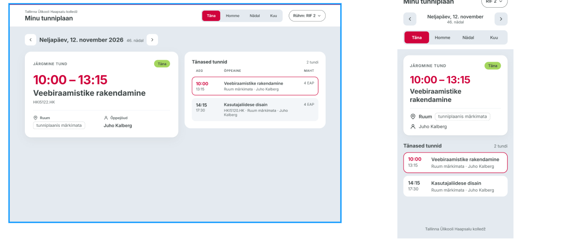

BPrompt - CLAUDE
Olen rakendusinformaatika üliõpilane ja teen kasutajaliideste disaini kursuse raames TLÜ Haapsalu kolledži olemasoleva tunniplaani kasutajaliidese ümberkujundust.
Lähteülesanne
Probleem: olemasolevas tunniplaanis on vajalik info olemas, kuid selle leidmist raskendavad suur infohulk ja ebaselge visuaalne hierarhia. Mobiilseadmes võib tunniplaani kasutamine olla ebamugav.
Sihtrühm: peamiselt üliõpilased.
Peamine kasutusjuht: üliõpilane avab tunniplaani, et kiiresti teada saada, millal toimub tema järgmine tund, mis ainega on tegemist ja millises ruumis tund toimub.
Kasutuskeskkond: eelkõige mobiiltelefon, kuid lahendus peab sobima ka arvutiekraanile.
Eesmärk: luua selge, kiiresti haaratav ja mugav tunniplaani kasutajaliides, kus järgmise tunni aeg, nimetus ja ruum on hõlpsasti leitavad.
Piirangud: kasutajaliides on eestikeelne, järgib Tallinna Ülikooli visuaalse identiteedi põhimõtteid ning arvestab ligipääsetavusega.
Tunniplaani tegelik sisu
Kasuta kujunduse alusena järgmist tunniplaani:
Tunniplaani aadress: https://start.hk.tlu.ee/sahtelbeta/tunniplaan/index.php
Rühm: RIF2
Kuupäev: 12. november 2026
Enne kujundamist loetle kõik selle rühma tunnid, mida sellel kuupäeval tunniplaanis näed. Too iga tunni kohta välja kellaaeg, aine nimetus ja ruum.
Kui sa ei pääse tunniplaani tegelikele andmetele ligi, ütle seda selgelt. Ära mõtle tunde, ruume ega muid andmeid ise välja.
Kujundusülesanne
Uue kasutajaliidese märksõnad:
Selge - Aine, kellaaeg ja ruum on kiiresti eristatavad.Rahulik - Tänane ja järgmine tund ei konkureeri liigse infoga.Struktureeritud - Tunnid on loogiliselt järjestatud ja rühmitatud.Kiire - Olulise info leiab minimaalse tegevuste arvuga.Usaldusväärne - Info on täpne, loetav ja professionaalselt esitatud.
Loo selle info ja lisatud moodboardi põhjal üks terviklik tunniplaani põhivaate kujundus.
Lähtudes lähteülesandest, kasuta minu lsatud moodboardi ja märksõnu.
Keskendu eelkõige sellele, et üliõpilane leiaks kiiresti järgmise tunni aja, nimetuse ja ruumi.
Ära lisa funktsioone, mida lähteülesanne ei nõua. Ära muuda ega mõtle välja tunniplaani sisu.
Tulemuseks soovin kasutajaliidese kavandit, milles on kasutatud minu moodboardi ja märksõnu. Kindlasti peab olema visuaalne tulemus, mitte ainult tekstilist kirjeldust.

